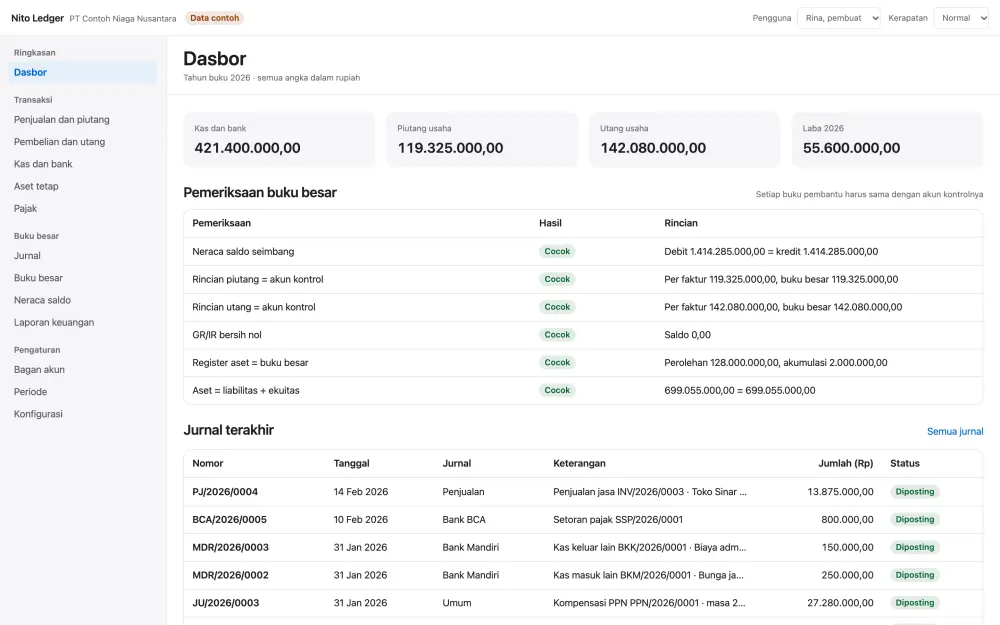

# nito-skill

Two skills for Claude Code.

- **nito-design** builds pages and tools with the proportions, rhythm, type
  and motion measured from apple.com, laid over your own palette and identity.
- **nito-accounting** answers accounting questions and builds accounting into
  any ERP from zero, Indonesian tax included, with code that is tested against
  worked journal entries.

**Live:** [landing page](https://riverroll.github.io/nito-skill/) ·
[showcase ledger](https://riverroll.github.io/nito-skill/example/ledger/)



## Install

From inside Claude Code:

```
/plugin marketplace add Riverroll/nito-skill
/plugin install nito-skill
```

To update later: `/plugin marketplace update nito-skill`, then
`/plugin install nito-skill` and `/reload-plugins`.

Or copy one skill into your own skills folder:

```sh
git clone https://github.com/Riverroll/nito-skill.git
cp -r nito-skill/skills/nito-design ~/.claude/skills/
cp -r nito-skill/skills/nito-accounting ~/.claude/skills/
```

## Use

Both skills load on their own when the work calls for them. Ask the way you
would ask a colleague:

| You ask | Skill | What happens |
|---|---|---|
| "Bikin landing page untuk produk kami." | nito-design | A measured type scale, rhythm in em, a picture on every screen, a clip where the product moves, short headlines |
| "Halaman PO ini terlalu sesak dan susah dibaca." | nito-design | Audits it in ERP mode, fixes row height, sticky headers and number alignment, keeps your colours |
| "Jurnal penjualan kredit Rp100 juta, diskon 5%, PPN?" | nito-accounting | Piutang Usaha 105,450,000 against Penjualan 95,000,000 and PPN Keluaran 10,450,000, with the rule, its source and the date the rate was last confirmed |
| "CRM kita cuma bikin invoice, gimana supaya ada dashboard keuangan?" | nito-accounting | Tier 0 integration: invoices and receipts post to a ledger, and the dashboard reads it |
| "Modul voyage mau disambung ke akuntansi." | nito-accounting | The voyage events, revenue from load to discharge, demurrage, bunkers, PPh 15, a P&L per voyage |
| "Bikin modul akuntansi dari nol untuk ERP baru." | nito-accounting | The build-from-zero guide: copy the schema, the service and the reports, seed the company, connect each module |

To call one by name, type `/nito-design` or `/nito-accounting`.

---

## nito-design

**A system, not a skin.** Applied to a design that already exists, it changes
spacing, rhythm, type discipline and motion, and leaves the palette, the
identity and the layout concept alone. A dark site stays dark. The skill
leads with token *roles* and measured relationships rather than Apple's hex
values, and the test suite enforces that: it asserts contrast ladders and
separation between ink steps, never a brand colour, and fails a page that
copied Apple's accent instead of mapping its own.

It applies whenever you ask for a marketing page, product page, landing page,
hero, feature grid or comparison table, or for something to look "like
Apple", "premium" or "high-end".

### Where the numbers come from

Every value is extracted from apple.com's own shipped stylesheets, not
estimated: 106 typography classes with their per-breakpoint overrides, the
SpaceKit spacing tokens, the easing curves ranked by how often each is used,
the breakpoint set, and the colour palette ranked by frequency across the
product pages. The copy rules come from measuring 338 headlines: median length
three words, 42% ending in a full stop.

### Audit an existing page

```sh
node tools/audit.mjs https://example.com
node tools/audit.mjs https://example.com --json before.json
node tools/audit.mjs https://example.com --baseline before.json
```

Reads computed styles out of a real headless browser at **1440 / 900 /
500px** (any stack, no instrumentation, changes nothing) and ranks what is
countably wrong, naming the elements:

```
  1. 6 accent hues in use
     150° ×29  180° ×98  210° ×56  240° ×5  270° ×98  330° ×23
       · 150°  div.space-y-10 > div.relative.pl-8 > div.absolute.left-0
       · 270°  div.space-y-4 > div.p-4.rounded-xl > p.text-violet-400/70
     -> Apple ships one. Pick the hue that already means 'action' on this page
        and map the rest to ink steps.
```

It also reports:
- sections that are all the same height: a long page with no rest in it is the
  main reason a correct page still reads as generated;
- scatter in text colours, radii, padding and durations;
- display sizes shipping `letter-spacing: normal`;
- headlines **scaled** on phone instead of re-picked, and large ones that never
  step down;
- text below WCAG AA against the background it actually sits on, and text
  under an ancestor stuck below full opacity;
- sticky elements that cannot stick because an ancestor clips scrolling;
- headline length against Apple's median of three words.

Three findings come from measuring the page in a second state: it sets
`prefers-reduced-motion` and names the clip slots that go blank, reports the
share of the screen that is a **gradient** (real Apple pages measure 0-4%),
and flags clips painted wider than their file and elements marked `hidden`
that still have a layout box. It walks the page first, so scroll-triggered
reveals are not counted as hidden content.

`--json` writes the raw measurements; `--baseline` prints the change against an
earlier run, which answers "did anything actually change?" with a number:

```
  change since baseline

     accent hues                        6 ↓ 1
     text colours                      33 ↓ 7
     corner radii                       5 ↓ 3
```

Run it **before** you change anything. Rhythm and tracking are what a page
feels like; the counts are what it looks like. Fixing rhythm on a site that is
already roughly spaced produces real improvements and a page its owner says
looks identical, and they are right.

### Restraint: the worked pair

`example/fix-me/before.html` and `after.html` are the **same page** (same
markup, same copy, same dark identity, same teal) with the restraint rules
applied to the second:

```
before   6 accent hues · 15 text colours · 5 display sizes tracked normal
         · 4 section paddings · a headline frozen at every width
after    nothing countable is off
```

Nothing was redesigned. The colour per card carried no meaning, so it became
one card treatment; nine opacity steps became three ink steps; every display
size got its tracking from the table; the padding collapsed onto one ladder.
`test/restraint.mjs` asserts all of that, and that the copy is byte-identical
between the two: a "fix" that rewrites the content is a different site.

### A correct page can still be dead

Restraint says what to take away, not what has to be there, so a page can
score 100/100 and be a blank canvas with good margins. Measured on eight
apple.com product pages, sampling what sits under a 64-point grid at every
screenful:

| What a visitor sees | apple.com | an earlier showcase page in this repo |
|---|---|---|
| photograph or video | **38%** | **0%** |
| flat surface colour | 51% | 88% |
| text | 12% | 8% |

`references/composition.md` carries the ratios, the subject hierarchy, how
hard to crop, how a long page changes pace, and the countable tells of a
generated page (gradient type, glass cards, emoji icons, three equal cards
forever, "elevate / seamless / unleash"). `references/imagery.md` is how to
source real images when the project has none, with licences and per-breakpoint
art direction. The audit measures it:

```
  what a visitor sees: 0% picture · 4% text · 92% flat colour  (apple.com: 38 / 12 / 51)

  1. only 0% of what a visitor sees is a picture
  2. 2 of 5 screenful(s) contain no image at all
  3. the largest type is only x3.76 the body size
```

`example/soul/` is the worked pair: nine tells and 0% picture, against zero
findings and 48% picture.

### Moving pictures

Measured off apple.com's shipped assets: **a three-second silent clip, 30fps,
one keyframe for the whole file, art-directed into three crops at two
densities**: a 0.88 portrait for phones, a 1.62 for tablets, a 2.06 at 1260px
for desktop, 260 KB on a 1&times; desktop screen. A flagship page carries 6 to
14; a category page carries none.

Two things follow that hand-built versions get wrong. A single-keyframe file
**cannot be scrubbed**: writing `currentTime` decodes from frame 0 every time.
And the clip is never alone: a `<picture>` sits in the same grid cell under
it, so a slow connection, a blocked request or `prefers-reduced-motion` lands
on a photograph. With reduced motion Apple does not slow the clip; it never
fetches it. A clip whose point is its end state carries both a first and a
last still, and the fallback shows the last.

`references/media.md` has the loader's measured windows, the ffmpeg recipes,
the byte budgets and the four image transitions with their shipped numbers.

```sh
tools/make-clip.sh master.mov out/           # or a photograph: it gets a 1.11x push
node tools/render-clip.mjs scene.html out/   # no footage at all: render one
```

**When there is no footage**, `tools/render-clip.mjs` renders one. A *scene*
is an HTML file exposing `setFrame(t)`, `t` from 0 to 1; the tool drives a
headless browser through 90 values, captures each paint and encodes the three
crops at two densities. Nothing animates by itself, so the output is the same
on a slow machine as on a fast one, and each crop is composed at its own
aspect rather than letterboxed. `example/scenes/` holds three; `example/motion/`
demonstrates the whole contract, and `example/motion/flat.html` is the same
content with every mistake in it.

### Components

`references/micro.md` is read straight out of apple.com's `--sk-dotnav-*`,
`--sk-paddlenav-*` and `--tabnav-*` token blocks: the 8px dot inside a 24px
target, the resting alpha of 0.42, hover at 120ms linear against a slide change
at 320ms ease-in-out, dots that taper instead of paginating, the 40ms stagger,
and the selector most hand-built carousels miss: `:focus-visible` on paddles
that are hidden until hover.

### Tools are not pages

An ERP, an admin panel or a dashboard shares the craft and almost none of the
numbers. `references/erp.md` carries the dense set: the 12/14/17px ladder that
was already in Apple's measured classes, one `--row-h` token the whole
geometry comes off, the table and form contracts, the semantic colour set
that is the one exemption to one accent, and why scroll-linked motion has no
place in a data grid.

```sh
node tools/audit.mjs http://localhost:3000/purchase-orders --mode erp
```

In that mode the audit stops asking for an 80px padding ladder and starts
flagging it, and checks what decides whether a grid is readable: alignment by
data type, a sticky header, a pinned identity column, `tabular-nums`, one row
height, 28px hit targets, a focus ring, truncation with something behind it.
`example/erp/` is the worked pair: the same purchase-order screen, 21 findings
down to none, every word of its data intact.

### Examples

| Page | Shows |
|---|---|
| `example/index.html` | Ridge, a marketing page for an invented product, with its own warm dark palette. One morning in order, 05:30 to 07:00, with the time carried through every section; three interface clips rendered from `example/scenes/` over the page's own photographs (public-domain USGS and NPS frames) |
| `example/fix-me/` | Restraint before and after |
| `example/soul/` | A correct but dead page, and the fix |
| `example/motion/` | The clip contract, and its broken twin |
| `example/erp/` | A dense tool before and after |

---

## nito-accounting

One accounting core, reused in every ERP. What changes per company is data:
the chart of accounts and the company configuration. What changes per year is
the tax and payroll parameters. The ledger logic does not change, and neither
does the way a module connects to it.

It is **knowledge**: ask any accounting question and it opens the right
reference, gives a balanced entry with Indonesian account names, names the
rule and its source with an evidence label, and says when a rate must be
re-checked.

It is **a build kit**: everything needed to put accounting into an ERP
without new research.

| Copy | Gives you |
|---|---|
| `assets/posting-core.mjs` | The rules and 61 posting events, each replayed from a worked entry |
| `assets/posting-service.mjs` | The service an ERP calls: post, reverse, an outbox worker; in-memory and MySQL repositories |
| `assets/reports.mjs` | Income statement, balance sheet, indirect cash flow, open items, aging, dashboard figures, margin per voyage or project |
| `assets/period-close.mjs` | Year-end closing, opening balances, FX revaluation |
| `assets/inventory-valuation.mjs` | Moving average and FIFO |
| `assets/seed-sql.mjs` | The setup SQL for a company: chart, account mapping, periods, numbering, bank accounts |
| `assets/ledger-schema.prisma` | The ledger and the tables around it, for MariaDB/MySQL |
| `assets/coa-template-id.json` | A default Indonesian chart, 29 accounts, to adapt |

### Building accounting from zero

`references/build-from-zero.md` is the order of work:

1. Decide five things with the business: framework (SAK Umum, SAK EP, SAK
   EMKM), PKP status, costing method, fiscal year and currency, integration
   tier.
2. Copy the assets.
3. Create the tables from the schema.
4. Seed the company with `seedSql` and run the SQL.
5. Wire the posting service.
6. Connect each module by the eight steps of the integration playbook.
7. Build the screens (nito-design's dense-tool mode; `example/ledger/` shows
   them).
8. Run the reconciliation checks as jobs.

### Connecting any ERP

The module owns the operation; the accounting service owns the ledger. A
module never writes a journal line: it sends an event and amounts by role,
and the company's account determination picks the accounts.
`references/integration-playbook.md` has the eight steps, the outbox, how to
handle edits and cancellations, and the tiers:

| Tier | The ERP has | It gets |
|---|---|---|
| 0 | A CRM or billing system that issues invoices | Revenue, receivables, aging, cash, a dashboard |
| 1 | + purchasing and expenses | A full profit and loss, payables, PPN settlement |
| 2 | + stock | Gross margin, stock tied to the ledger |
| 3 | + payroll and fixed assets | Complete statements for a trading or service company |
| 4 | + multi-currency, group companies, close | Cash flow, closed years, a group view |

Domain maps in `references/domains/` have the steps done already: CRM and
billing, supply chain (landed cost, transfers, counts), voyage and shipping
(revenue from load to discharge, demurrage, bunkers, PPh 15, PPN under PP
49/2022), and manufacturing, projects, trucking, rental, retail and services.

### For the team

`references/team-primer-id.md` is accounting for developers, in Bahasa
Indonesia: debit and credit by account type, the terms the code uses, the ten
rules of the system, when a module must send an event, and the taxes that
come up most.

### What it does not do

- It is a guide for building software, not tax or legal advice, and it does
  not replace an accountant.
- Rates and caps are dated and labelled in `references/values-to-verify.md`;
  several are unverified or disputed between sources. Confirm before use.
- The MySQL repository and the SQL have not been run against a database:
  `references/sql-checks.md` is what to run first.
- Payroll calculation (gross to net, TER, BPJS caps) and tax filing exports
  (Coretax, e-Bupot) are not built; the postings for them are.
- The shipping and voyage rules rest on secondary sources, and say so.

---

## The showcase ledger

[Open it](https://riverroll.github.io/nito-skill/example/ledger/).
`example/ledger/index.html` is a working accounting ERP for an invented
company, built on both skills, in one file.

**The accounting** is nito-accounting's posting core, imported unchanged.
Sales, purchases, receipts, payments, fixed assets, depreciation, the PPN
settlement and tax payments are documents that send amounts by role.

- Each cash and bank account (Kas, Bank BCA, Bank Mandiri) is a payment
  journal with its own numbers. Register a payment from the invoice: where the
  money went, the method, the bank's reference, a fee, a part payment.
- The Kas dan bank page has transfers, other cash lines (interest, charges)
  and a reconciliation against the bank statement.
- Manual journals need a second user to approve them.
- Posted entries are never edited: cancelling a document posts a reversing
  entry, and both stay.
- Closed periods, inactive accounts, manual postings to control accounts,
  unbalanced entries and roles with no account are refused, and the screen
  shows the core's own reason.
- The example data is the worked entries from the references, posted through
  the same commands the forms use, and the dashboard checks every subledger
  against its control account.

**The design** is nito-design's dense-tool mode: one row height, a 14px data
ladder, sticky headers and a pinned identity column, right-aligned tabular
numbers, tinted status badges that carry a word, one inspector column instead
of modals, light and dark, and a phone layout. The ERP audit reports nothing
on it.

Data lives in the browser's localStorage. It is a showcase, not a product: no
server, no login, no multi-company switch.

## The landing page

[Open it](https://riverroll.github.io/nito-skill/). `index.html` at the repo
root, built with nito-design's marketing mode and its own accent. Its pictures
are captures of the pages in `example/`, including a clip of the ledger
posting an invoice, and its journal demo runs the real posting core in the
page. GitHub Pages publishes it from the root of `main` with no build step.

To run either locally:

```sh
python3 -m http.server 4100   # then http://localhost:4100/ and /example/ledger/
```

## What's inside

```
index.html                       the landing page
tools/audit.mjs                  audit any live URL, marketing or ERP mode
tools/make-clip.sh               build one clip's six-file ladder and its stills
tools/render-clip.mjs            render a clip from a scene you wrote
skills/nito-design/
  SKILL.md                       what to change and what to leave alone, token roles, the rules
  references/                    restraint, dark, stacks, typography, layout, motion, media,
                                 composition, imagery, components, micro, erp, voice
  assets/apple-base.css          tokens and primitives for a new page (placeholder palette: replace it)
  assets/type-scale.json         all 106 measured typography classes
skills/nito-accounting/
  SKILL.md                       nine rules, and which file answers which question
  references/                    build-from-zero, integration playbook, event catalogue,
                                 domains/ (CRM, supply chain, voyage, others), 15 topic files,
                                 121 worked entries, SQL checks, team primer, values to re-verify
  assets/                        posting core, posting service, reports, period close,
                                 inventory valuation, seed SQL, schema, chart template
example/                         the worked pairs, the Ridge page, the showcase ledger
research/                        the two research reports the skills were built from
test/                            the suites below
```

## Testing

```sh
node test/accounting.mjs         # 535: every worked entry balances, every event replays, statements tie out, the service posts once
node test/ledger.mjs             # 58: the showcase ledger in a real browser: data ties out, rules refused, ERP audit clean
node test/site.mjs               # 29: the landing page: links, live journal, reduced motion, audit, and the counts it quotes
node test/structure.mjs          # 88: the skills load, references resolve, scenes and tools hold their contract
node test/erp.mjs                # 37: the dense-tool pair
node test/composition.mjs        # 26: the soul pair
node test/gallery.mjs            # 18: the carousel: paddles, dots, keyboard
node test/restraint.mjs          # 16: the before/after pair
node test/media.mjs              # 92: the clip ladder, the stack, the fallbacks (89 pass, see below)
node test/conformance.mjs <url>  # a page's computed styles against the measured values
```

The browser suites need Google Chrome; set `CHROME` to its path if it is not
in the default place. `test/media.mjs` reads the six clip files off disk (moov
before mdat, no audio track, inside the byte budget, three crops at three
aspect ratios), then drives a browser through the loader at 1440px, at
2&times; and at 420px, the drop-to-still path with the file failing, reduced
motion, and scripting off. It currently passes 89 of 92: the three playback
checks fail where headless Chrome does not decode the clip (readyState 0), and
the cause has not been investigated yet.

The design palette is checked as **relationships**: three separated ink
steps, an alt surface that is a near neighbour of the base, AA contrast on
each role, never specific colours. A check that asserted `#0071e3` would force
every page built with this skill into being a clone, so one check asserts the
opposite: that the accent is *not* Apple's.

The accounting suite re-adds every worked journal entry in the references,
replays every posting event from one, ties the statements, the closing, the
revaluation and the inventory valuation to the figures in the references, and
drives the posting service through retries, a race on one key, a closed
period and the outbox.

---

nito-design teaches the *system* (proportion, rhythm, restraint, motion) and
ships none of Apple's content: no fonts, photography, product renders, icons
or wordmarks, and no part of it asks you to adopt Apple's colours. Apple,
iPhone, Mac, iPad, macOS and SF Pro are trademarks of Apple Inc. This project
is not affiliated with or endorsed by Apple.

MIT licence, for the skills' own text, code and CSS.
